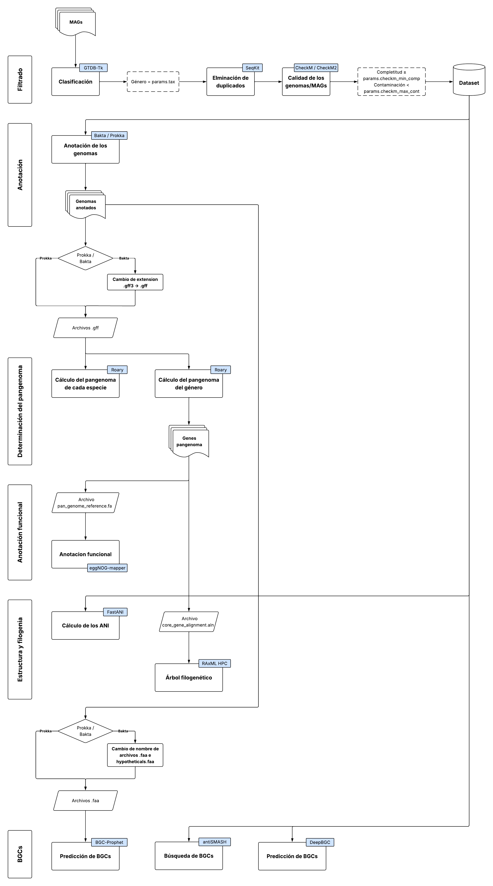

This automated computational workflow was designed to process Metagenome-Assembled Genomes (MAGs) and isolate genomes, performing rigorous quality control, pangenome characterization, phylogenetic analysis, and the prediction of Biosynthetic Gene Clusters (BGCs).

The pipeline is structured into six main stages:
1. Quality Control and Filtering: Initial input MAGs undergo taxonomic classification using GTDB-Tk to retain only sequences belonging to the target genus. Sequence duplicates are subsequently removed using SeqKit. Genome quality is assessed via CheckM/CheckM2, strictly filtering the dataset based on predefined thresholds for minimum completeness and maximum contamination. Genomes passing these criteria form the final, high-quality reference dataset.
2. Genome Annotation: The filtered dataset is structurally and functionally annotated utilizing either Bakta or Prokka. The pipeline includes an automated formatting step to standardize the output extensions (converting .gff3 to .gff) to ensure compatibility with downstream pangenomic tools.
3. Pangenome Determination: The standardized .gff files are processed with Roary to compute both species-specific and genus-level pangenomes. This stage extracts the full pangenome gene repertoire, generating a reference FASTA file (pan_genome_reference.fa) and a core gene alignment file (core_gene_alignment.aln).
4. Functional Annotation: The generated pangenome reference file (pan_genome_reference.fa) is subjected to comprehensive functional annotation using eggNOG-mapper to categorize and assign biological functions to the identified gene families.
5. Phylogenomic and Structural Analysis: To resolve evolutionary relationships and genomic similarity, the pipeline executes two parallel analyses. First, FastANI is used to calculate the Average Nucleotide Identity (ANI) across the annotated genomes. Second, the core gene alignment generated by Roary is used as input for RAxML-HPC to reconstruct a robust maximum-likelihood phylogenetic tree.
6. Biosynthetic Gene Cluster (BGC) Detection and Prediction: To comprehensively mine the genomes for antimicrobial and secondary metabolite potential, the workflow implements a multi-tool approach:
* antiSMASH and DeepBGC are executed directly on the filtered genomic dataset to search and classify BGCs using rule-based and deep-learning methodologies.
* BGC-Prophet is utilized for additional BGC prediction, taking the annotated protein sequences (.faa files) as input. This branch includes an automated parsing step to rename files (e.g., to hypotheticals.faa) depending on whether Prokka or Bakta was used upstream, ensuring seamless execution.

---

---

### Usage
nextflow run main.nf -params-file my_params.yml -profile standard,conda
